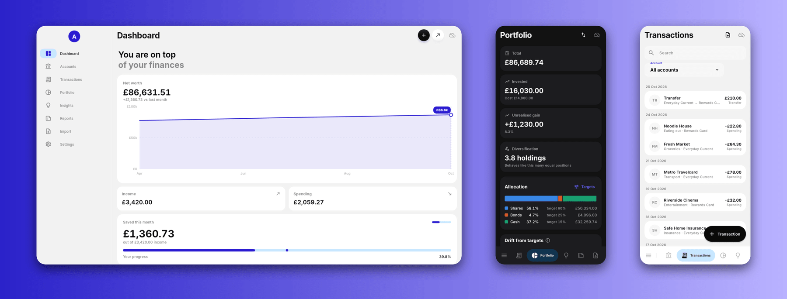
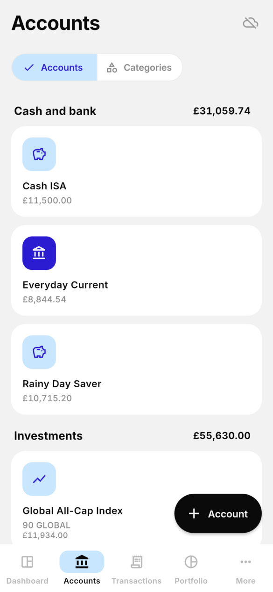
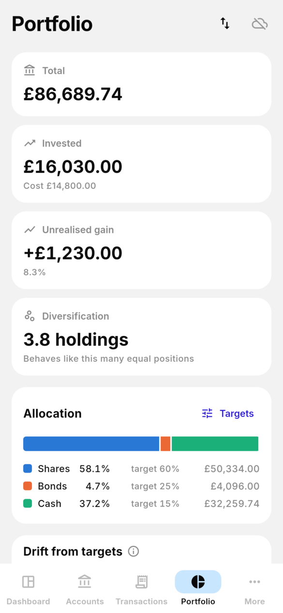
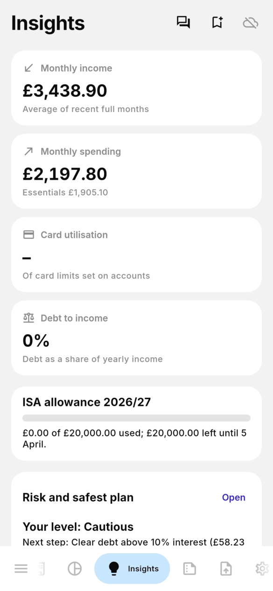
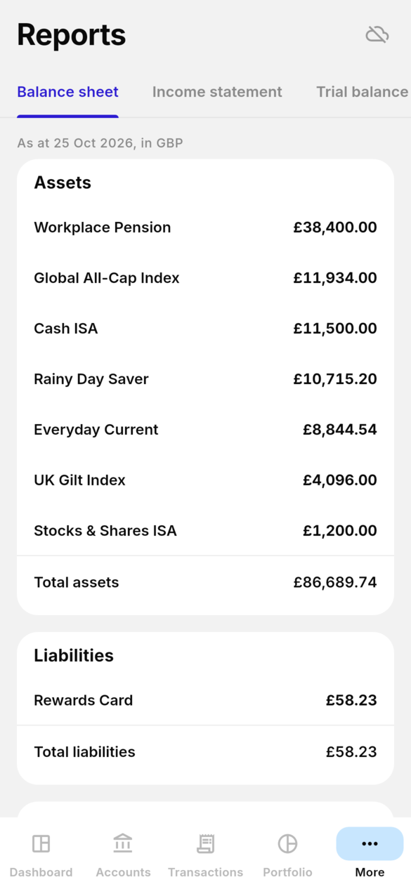
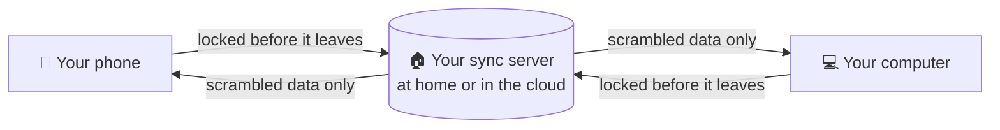

<h1 align="center">
  <br>
  <a href="https://github.com/sudharamachandranrajeev/artha"></a>
  <br>
  Artha
  <br>
</h1>

<h4 align="center">All your money in one private place: accounts, spending, bills and investments, on your phone and computer.</h4>

<p align="center">
  <a href="https://github.com/sudharamachandranrajeev/artha/releases"></a>
  
  
  <a href="https://github.com/sudharamachandranrajeev/brahma"></a>
</p>

<p align="center">
  <a href="#-what-it-does">What it does</a> •
  <a href="#-get-started">Get started</a> •
  <a href="#-how-it-works">How it works</a> •
  <a href="#-faq-and-troubleshooting">FAQ</a> •
  <a href="#%EF%B8%8F-for-developers">For developers</a>
</p>

<p align="center">
  
</p>

Artha is a money manager for people who want the full picture without handing their bank data
to a company. It keeps everything on your own devices, locked with encryption, and can sync
between them through a server you own. Status: **beta**. It works day to day, but keep your
bank's own records too.

## ✨ What it does

- 🏦 **Every account in one view** – current accounts, savings, ISAs, cards, loans, pensions and
  crypto, each in its own currency.
- 🧾 **Bank statements in, not typed in** – import CSV, OFX, QFX, QIF or PDF files. Artha spots
  duplicates and transfers, and asks you to check anything unsure.
- 📈 **Investments made clear** – see what you own, what it cost, how far you are from your target
  mix, and where new money should go.
- 📅 **Bills and the next 90 days** – budgets, subscriptions and upcoming bills, with a forecast of
  your balance and room for one-off payments.
- 💡 **Insights that fit you** – risk checks, "what if" tests (income stops, markets fall) and a
  safety-first plan, plus live UK interest and inflation rates. You can switch the news off.
- 🤖 **Ask Artha** (optional) – ask a money question and get a short answer from Claude, using your
  own Anthropic key. It sees rounded figures only, never names.
- 📊 **Proper reports** – balance sheet, income statement and trial balance.
- 🔒 **Private by design** – data is encrypted on the device. Sync is optional, and the server
  only ever holds scrambled data.
- 🎨 **Friendly** – a hint beside every control, light and dark themes, and several colour
  palettes.

## 📸 Screenshots

<table>
  <tr>
    <td align="center"><br><sub>Dashboard</sub></td>
    <td align="center"><br><sub>Accounts</sub></td>
    <td align="center"><br><sub>Transactions (dark)</sub></td>
  </tr>
  <tr>
    <td align="center"><br><sub>Portfolio</sub></td>
    <td align="center"><br><sub>Insights</sub></td>
    <td align="center"><br><sub>Reports</sub></td>
  </tr>
</table>

<p align="center">
  <br>
  <sub>Portfolio on a desktop window</sub>
</p>

<sub>All screenshots show a made-up household, rendered from the current code.</sub>

## 🚀 Get started

### Step 1 – Download

Open the [releases page](https://github.com/sudharamachandranrajeev/artha/releases) and, under
the newest release, pick the file for your device:

| Your device | File to download | Works on |
| --- | --- | --- |
| 🐧 Linux computer | `Artha-<version>-linux-x64.tar.gz` | Ubuntu 22.04+, Debian 12+, Fedora, Arch, Omarchy (Intel/AMD 64-bit) |
| 🪟 Windows computer | `Artha-<version>-windows-x64-setup.exe` | Windows 10 and 11 |
| 🤖 Android phone | `Artha-<version>-android.apk` | Android 7 and newer |

Each release also has `SHA256SUMS.txt`, a list of fingerprints to check the files are genuine.

### Step 2 – Install

<details>
<summary><b>🐧 Linux</b></summary>

1. Open a terminal in the folder where the download landed.
2. Unpack it and run the installer as your normal user (not `sudo`):
   ```sh
   tar -xzf Artha-*-linux-x64.tar.gz
   cd artha-*-linux-x64 && bash install.sh
   ```
3. Open **Artha** from your app menu.

It installs for your user only. Artha needs the desktop keyring (the app that stores passwords)
running and unlocked. To remove Artha later: `bash ~/.local/lib/artha/install.sh --uninstall`.
For a one-command install that also fetches missing system packages, see the
[Linux install guide](docs/install-linux.md).

</details>

<details>
<summary><b>🪟 Windows</b></summary>

1. Double-click `Artha-<version>-windows-x64-setup.exe`. No admin rights needed.
2. Windows may say *"Windows protected your PC"*. This appears because the app isn't paid-signed
   yet, not because it is harmful. Click **More info → Run anyway**.
3. Follow the installer, then open **Artha** from the Start menu.

Prefer no installer? Download `…-windows-x64-portable.zip`, unzip it anywhere and run `artha.exe`.

</details>

<details>
<summary><b>🤖 Android</b></summary>

1. Open the downloaded `.apk` on your phone.
2. If Android asks, allow installs from your browser or file manager. This is normal for apps
   from outside the Play Store.
3. Tap **Install**, then **Open**.

Newer versions install over the top and keep your data.

</details>

### Step 3 – First launch

1. **Choose your main currency**, usually the one you are paid in, then **Get started**. Each
   account can still use its own currency.
2. **Add an account**: open **Accounts → Add account**. Start with one current account.
3. **Bring in your transactions**: on **Transactions**, tap **+ Transaction**, or **Import
   statement** to load a file from your bank. Check the suggested matches, then import.
4. **Look at the dashboard**: net worth, income, spending and the next 90 days.

The full walk-through is in [Your first five minutes with Artha](docs/quick-start.md).

### Step 4 (optional) – Use it on more than one device

1. Set up a free sync server, at home or on Cloudflare. The
   [Brahma sync server guide](https://github.com/sudharamachandranrajeev/brahma/tree/main/server)
   walks you through it, step by step.
2. In Artha, open **Settings → Sync → Create account**.
3. **Write down the recovery key** it shows and keep it somewhere safe, away from the device.
4. On your next device, choose **Join from another device** and compare the codes on both screens.

> [!NOTE]
> Release 0.2.0-beta.15 syncs through the older [Artha server](server/README.md). The next
> release adds a guided first-start choice between "this device only", a home server and a cloud
> server, using the shared Brahma server.

## 🧭 How it works



- **On each device**, Artha keeps your data in an encrypted database. Without your key it is
  unreadable.
- **Sync is optional.** Without it, nothing leaves the device.
- **With sync**, each device encrypts its changes before sending them. The server stores and
  passes them on, but cannot read balances, payees or amounts. Only your devices hold the key.
- **Downloads Artha makes on its own**: exchange rates, and public UK rates and headlines for
  Insights (switch off in **Settings → News and rates**). Nothing about you is sent.

> [!IMPORTANT]
> Your password and recovery key are the only ways to unlock synced data. If you lose both, nobody
> can recover it, not even the server owner. On Android, uninstalling the app deletes its data, so
> sync or export first.

## ❓ FAQ and troubleshooting

<details>
<summary><b>Do I need an account or the internet?</b></summary>

No. Artha works fully offline on one device. You only need a server if you want sync.
</details>

<details>
<summary><b>Windows says the app might be unsafe</b></summary>

The build isn't code-signed (a paid certificate). Click **More info → Run anyway**. Check the file
against `SHA256SUMS.txt` on the release if you want to be sure it is genuine.
</details>

<details>
<summary><b>Linux: Artha stops at start and talks about a missing key</b></summary>

The key that unlocks your data lives in the desktop keyring. Make sure your keyring app is
running and unlocked, then start Artha again. Artha stops on purpose rather than make a new key,
so your existing data stays recoverable.
</details>

<details>
<summary><b>Which banks' statements work?</b></summary>

Any bank that exports CSV, OFX, QFX or QIF, and most PDF statements. For CSV files, check that the
date and amount columns are read correctly in the preview before importing.
</details>

<details>
<summary><b>Where is my data stored?</b></summary>

Linux: `~/.local/share/dev.artha.artha`. Windows: `%APPDATA%\Artha`. Android: inside the app.
Uninstalling on Linux or Windows leaves it in place.
</details>

<details>
<summary><b>Does Ask Artha cost money?</b></summary>

It uses your own Anthropic API key, so questions are billed to your Anthropic account. The key
stays in your system keychain, never in the database or in sync. It is off until you add a key.
</details>

## 🛠️ For developers

<details>
<summary>Build from source, test and release</summary>

You need [Git](https://git-scm.com) and [Flutter](https://flutter.dev) 3.47.

```bash
git clone https://github.com/sudharamachandranrajeev/artha
cd artha
flutter pub get
flutter run -d linux        # or windows, or an Android device

flutter analyze && flutter test                                       # check and test
ARTHA_SHOTS=/tmp/artha-shots flutter test test/screenshots_test.dart  # render the screenshots
scripts/make-icons.sh                                                 # app icons from branding/artha.svg
```

- Live tests (`test/*live_test.dart`) also run against a real sync server when one is set up.
  For development, run `scripts/run-local-server.sh`.
- CI runs everything on each push. A `v*` tag builds, smoke-tests and publishes the Android,
  Windows and Linux builds (`.github/workflows/release.yml`).
- Changes per version: [CHANGELOG.md](CHANGELOG.md). Design notes: [docs/](docs/).

</details>

<details>
<summary>Credits</summary>

- [Flutter](https://flutter.dev) and [Riverpod](https://riverpod.dev)
- [drift](https://drift.simonbinder.eu) over [SQLite3MultipleCiphers](https://utelle.github.io/SQLite3MultipleCiphers/)
  for the encrypted database
- [PocketBase](https://pocketbase.io) for the original sync server, and
  [cryptography](https://pub.dev/packages/cryptography) for end-to-end encryption
- [fl_chart](https://pub.dev/packages/fl_chart), [pdfrx](https://pub.dev/packages/pdfrx) (PDFium),
  [xml](https://pub.dev/packages/xml), [qr](https://pub.dev/packages/qr),
  [flutter_secure_storage](https://pub.dev/packages/flutter_secure_storage),
  [file_picker](https://pub.dev/packages/file_picker), [url_launcher](https://pub.dev/packages/url_launcher)
- [Inter](https://rsms.me/inter/) font
- Exchange rates: European Central Bank reference rates via [Frankfurter](https://frankfurter.dev)
- Rates and news: Bank of England, ONS, FCA, HMRC, MoneySavingExpert and BBC Business public feeds
- [Claude](https://www.anthropic.com/claude) by Anthropic for the optional Ask Artha

</details>

## Related

Artha is one app in the **Brahma** family. They share one sign-in and one sync server.

| App | What it does |
| --- | --- |
| [brahma](https://github.com/sudharamachandranrajeev/brahma) | The shared core and the all-in-one app |
| [graha-anveshana](https://github.com/sudharamachandranrajeev/graha-anveshana) | Find a home to rent or buy |
| [vahana-anveshana](https://github.com/sudharamachandranrajeev/vahana-anveshana) | Find a car |
| [udyoga](https://github.com/sudharamachandranrajeev/udyoga) | Career and job hunting |
| [vidya](https://github.com/sudharamachandranrajeev/vidya) | Learning, flashcards and focus |

## License

No licence has been chosen yet; all rights reserved.

---

> GitHub [@sudharamachandranrajeev](https://github.com/sudharamachandranrajeev)
